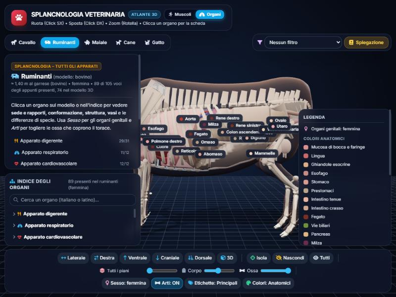
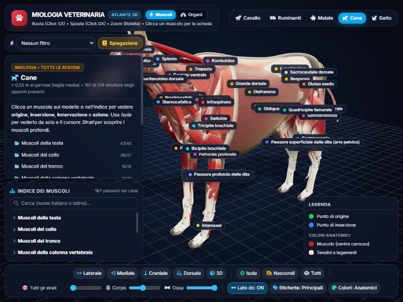
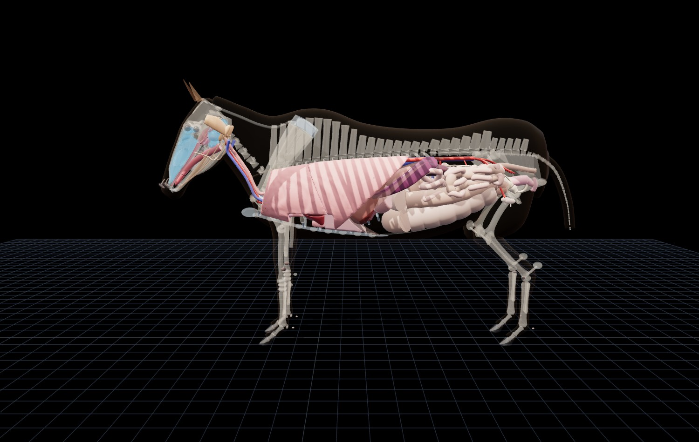
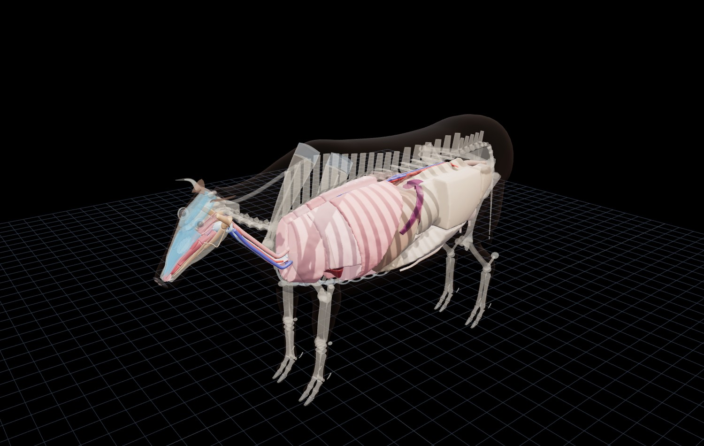

# Atlante 3D veterinario: muscoli e organi

Atlante anatomico interattivo di **cavallo, ruminanti (bovino), maiale, cane e gatto**, con due modalità: **Muscoli** (miologia) e **Organi** (splancnologia).

**Provalo online: [atlante3dmiologia.netlify.app](https://atlante3dmiologia.netlify.app)**

## Cosa contiene
- **Muscoli**: oltre 170 voci tra muscoli di testa, collo, tronco, colonna, coda, addome e arti, con origine, inserzione, innervazione, azione e note per specie. Filtro per nervo, livelli di profondità, vista mediale e lato destro.
- **Organi**: apparati digerente, respiratorio, cardiovascolare, urinario, genitale maschile e femminile, ghiandole endocrine, organi linfatici e tegumento, in 105 voci e 218 parti. Gli organi stanno nelle cavità del corpo, ai livelli vertebrali e costali di ciascuna specie. Ogni scheda riporta sede e rapporti, conformazione, struttura, mezzi di fissità, vasi, funzione, sviluppo, riconoscimento in sala settoria e differenze di specie; cavità e sierose, sviluppo embrionale, annessi e placenta sono descritti in schede dedicate.
- Le differenze di specie si vedono anche nel modello: il grosso colon a doppio ferro di cavallo del cavallo, i prestomaci e l'ansa spirale del bovino, il colon a turbante del maiale, le corna uterine a corno d'ariete della vacca, circonvolute della scrofa e rettilinee della cagna.

## Come si usa
- Si ruota con il tasto sinistro, si sposta con il destro e si ingrandisce con la rotella; un clic su un muscolo o su un organo apre la sua scheda.
- In alto si scelgono la modalità (Muscoli | Organi) e la specie; il menu dei filtri evidenzia i muscoli di un nervo oppure gli organi di un apparato o di una cavità; l'indice ha la ricerca per nome italiano o latino.
- In basso: viste laterale, mediale o destra, craniale, dorsale, ventrale (negli Organi) e 3D; isolamento della selezione; livelli di profondità; trasparenza di corpo e ossa; etichette; colori anatomici o didattici. Negli Organi anche il sesso (♀/♂) e gli arti, che si possono nascondere per vedere il torace.
- Funziona anche da telefono. Per aprire direttamente gli organi: [atlante3dmiologia.netlify.app/#organi](https://atlante3dmiologia.netlify.app/#organi).

| | |
|---|---|
|  |  |

## Tecnologia
Un'unica pagina HTML, `index.html`: scheletro, muscoli e organi vengono generati in modo procedurale con Three.js all'apertura della pagina, senza modelli 3D esterni. Servono una connessione a internet per le librerie (Three.js, Tailwind CSS, Font Awesome) e un browser recente; per usarlo in locale basta aprire `index.html`.

## Avvertenze
È uno strumento di studio. Le forme sono schematiche: posizione, rapporti e livelli degli organi sono curati, i dettagli morfologici no. I testi riassumono appunti di anatomia veterinaria, integrati con i testi di riferimento dove erano lacunosi o incoerenti, e non sostituiscono i manuali né la dissezione.

## Licenza
© 2026 Federico Cattelan. L'atlante (pagina, testi e immagini) è distribuito con licenza [Creative Commons Attribuzione - Non commerciale 4.0 Internazionale (CC BY-NC 4.0)](https://creativecommons.org/licenses/by-nc/4.0/deed.it): si può usare, condividere e modificare per scopi non commerciali, citando l'autore, indicando la licenza e segnalando le eventuali modifiche. Per qualsiasi uso commerciale serve il permesso dell'autore.

Il testo legale è nel file [LICENSE](LICENSE); esiste anche la [traduzione ufficiale italiana](https://creativecommons.org/licenses/by-nc/4.0/legalcode.it). Le librerie caricate dalla pagina (Three.js, Tailwind CSS, Font Awesome) hanno le proprie licenze.
